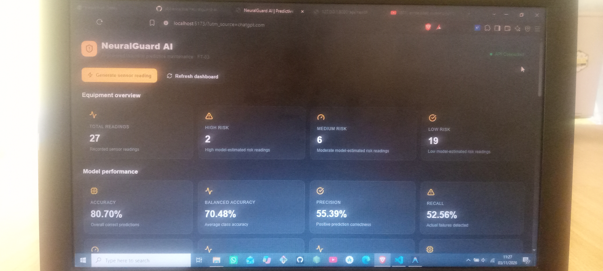
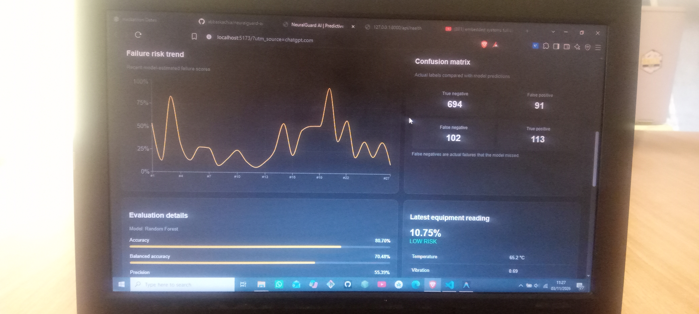
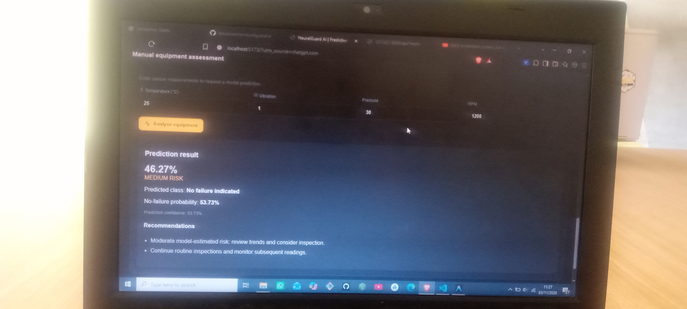

# NeuralGuard AI
### AI-Powered Predictive Maintenance for Industry

Neural Storm 2026 — Future Tech Track (FT-03)

NeuralGuard AI is an AI-powered predictive maintenance prototype designed to analyse industrial equipment sensor readings and estimate potential equipment failure risk before a breakdown occurs.

The system uses machine-learning techniques to analyse temperature, vibration, pressure, and rotational speed (RPM). It provides risk classifications, prediction results, equipment monitoring, and maintenance recommendations through an interactive web dashboard.

> **Project status:** Hackathon prototype. The current implementation uses synthetic equipment telemetry for model training, evaluation, and simulation. It has not yet been validated using real industrial equipment data and must not be used as the sole basis for safety-critical maintenance decisions.

---

## 1. The Problem

Unexpected industrial equipment failures can result in:

- Production downtime.
- Expensive repairs and equipment replacement.
- Reduced operational efficiency.
- Increased maintenance costs.
- Potential workplace safety risks.

Traditional maintenance approaches may rely on fixed inspection schedules or react only after equipment problems become noticeable.

NeuralGuard AI explores how machine learning can support predictive maintenance by identifying potentially abnormal equipment conditions from sensor readings.

## 2. Our Solution

NeuralGuard AI provides a monitoring and prediction platform that:

1. Collects or simulates equipment sensor readings.
2. Analyses temperature, vibration, pressure, and RPM.
3. Uses a Random Forest classification model to estimate failure risk.
4. Classifies readings into LOW, MEDIUM, or HIGH risk categories.
5. Displays equipment readings and historical risk trends.
6. Provides recommendations to support maintenance inspections.

The goal is to help maintenance personnel identify equipment conditions that may require further investigation.

## 3. Key Features

- **Predictive maintenance:** Machine-learning-based equipment failure-risk estimation.
- **Live sensor simulation:** Generate simulated equipment telemetry.
- **Manual equipment assessment:** Enter sensor values and analyse them.
- **Risk classification:** LOW, MEDIUM, and HIGH risk categories.
- **Interactive dashboard:** Monitor equipment readings and model performance.
- **Historical monitoring:** View previous readings and risk trends.
- **Confusion matrix:** Inspect model classification outcomes.
- **Maintenance recommendations:** Receive suggestions based on sensor conditions.
- **API integration:** React frontend communicates with a FastAPI backend.

## 4. Application Screenshots

### Dashboard


### Model Performance and Confusion Matrix


### Manual Prediction


## 4. Technology Stack

| Component | Technology |
|---|---|
| Frontend | React |
| Frontend tooling | Vite |
| Charts | Recharts |
| Icons | Lucide React |
| Backend | Python |
| API framework | FastAPI |
| Machine learning | Scikit-learn |
| ML algorithm | Random Forest Classifier |
| Data processing | Pandas, NumPy |
| Model evaluation | Scikit-learn metrics |

## 5. System Architecture

```text
       INDUSTRIAL EQUIPMENT
                |
                v
       SENSOR DATA INPUT
                |
     +----------+----------+
     |          |          |
 Temperature  Vibration  Pressure
                |
               RPM
                |
                v
       FASTAPI BACKEND
                |
                v
       DATA PROCESSING
                |
                v
       RANDOM FOREST MODEL
                |
                v
       FAILURE-RISK ESTIMATION
                |
       +--------+--------+
       |        |        |
       LOW    MEDIUM    HIGH
       |        |        |
       +--------+--------+
                |
                v
       MAINTENANCE GUIDANCE
                |
                v
       REACT DASHBOARD
                |
                v
       VISUAL MONITORING
```

## 6. Machine Learning Model

NeuralGuard AI uses a **Random Forest Classifier** to estimate potential equipment failure risk.

### Input features

| Sensor feature | Description |
|---|---|
| Temperature | Equipment operating temperature |
| Vibration | Equipment vibration measurement |
| Pressure | Operating pressure |
| RPM | Rotational speed |

### Model configuration

| Parameter | Value |
|---|---:|
| Algorithm | Random Forest |
| Number of estimators | 180 |
| Maximum depth | 10 |
| Minimum samples per leaf | 3 |
| Class weighting | Balanced |
| Random state | 42 |
| Dataset size | 5,000 records |
| Training samples | 4,000 |
| Testing samples | 1,000 |
| Train/test split | 80/20 |

The dataset is synthetic and is used to demonstrate the predictive maintenance workflow.

## 7. Model Evaluation Results

The model was evaluated using a stratified holdout test set of 1,000 synthetic records.

| Evaluation metric | Result |
|---|---:|
| Accuracy | 80.70% |
| Balanced Accuracy | 70.48% |
| Precision | 55.39% |
| Recall | 52.56% |
| F1 Score | 53.94% |
| ROC-AUC | 75.30% |
| PR-AUC | 55.38% |
| Brier Score | 0.1479 |

### Confusion Matrix

| Actual / Predicted | No Failure | Failure |
|---|---:|---:|
| No Failure | 694 | 91 |
| Failure | 102 | 113 |

### Understanding the results

- **Accuracy:** Percentage of all test predictions classified correctly.
- **Balanced accuracy:** Average recall across both classes.
- **Precision:** How many predicted failure cases were actually failures.
- **Recall:** How many actual failure cases the model identified.
- **F1 score:** Balance between precision and recall.
- **ROC-AUC:** Measures the model's ability to distinguish between the two classes.
- **PR-AUC:** Summarises precision and recall performance.
- **Brier score:** Measures probability prediction error; lower values are better.

**Important limitation:** The model missed 102 of the 215 actual positive cases in the synthetic test set. Its recall was 52.56%. This means the current model is a prototype, not a validated industrial failure-detection system.

## 8. Risk Classification

The application uses the following risk-score thresholds:

| Risk score | Risk classification |
|---|---|
| Below 40% | LOW |
| 40% to below 70% | MEDIUM |
| 70% and above | HIGH |

The predicted class uses a separate 50% classification threshold:

- Below 50%: No failure indicated.
- 50% and above: Potential failure.

Therefore, a MEDIUM risk score can still have a predicted class of "No failure indicated". Risk category and predicted class describe different things.

## 9. API Endpoints

The backend exposes the following endpoints:

| Method | Endpoint | Purpose |
|---|---|---|
| GET | `/` | API information |
| GET | `/api/health` | Backend and model health |
| GET | `/api/metrics` | Machine-learning evaluation metrics |
| GET | `/api/telemetry/latest` | Latest equipment reading |
| GET | `/api/telemetry/history` | Historical telemetry |
| GET | `/api/summary` | Equipment monitoring summary |
| POST | `/api/simulate` | Generate a simulated sensor reading |
| POST | `/api/predict` | Analyse sensor inputs and estimate risk |

Interactive API documentation is available through:

`http://127.0.0.1:8000/docs`

### Example health response

```json
{
  "status": "ok",
  "model_loaded": true,
  "data": "synthetic"
}
```

### Example prediction inputs

The prediction endpoint accepts equipment sensor readings:

```json
{
  "temperature": 95,
  "vibration": 12,
  "pressure": 20,
  "rpm": 2800
}
```

The response includes a risk score, risk level, predicted class, failure and no-failure scores, and maintenance recommendations.

## 10. Installation and Setup

### Prerequisites

Install the following:

- Python 3.10 or newer.
- Node.js and npm.
- Git.
- Visual Studio Code (recommended).

### Clone the repository

```bash
git clone https://github.com/abbaskachia/neuralguard-ai.git
cd neuralguard-ai
```

[Repl with the actual repository URL.](https://github.com/abbaskachia/neuralguard-ai.git)

### Backend setup

Open a terminal:

```bash
cd backend
```

Create a virtual environment:

```bash
python -m venv .venv
```

Activate it on Windows:

```bash
.venv\Scripts\activate
```

Install dependencies:

```bash
pip install -r requirements.txt
```

Start the FastAPI server:

```bash
uvicorn app.main:app --reload
```

Backend address:

`http://127.0.0.1:8000`

API documentation:

`http://127.0.0.1:8000/docs`

### Frontend setup

Open another terminal:

```bash
cd frontend
```

Install dependencies:

```bash
npm install
```

Start the development server:

```bash
npm run dev
```

Frontend address:

`http://localhost:5173`

Keep both backend and frontend terminals running while using the dashboard.

## 11. Testing

The prototype has been manually tested for the following:

| Test | Result |
|---|---|
| Backend health check | Passed |
| ML model loading | Passed |
| Frontend API connection | Passed |
| Sensor simulation | Passed |
| Manual prediction | Passed |
| Risk classification | Passed |
| Dashboard updates | Passed |

### Example prediction tests

**Test A — Normal-range input**

| Input | Value |
|---|---:|
| Temperature | 25 |
| Vibration | 1 |
| Pressure | 30 |
| RPM | 1200 |

Observed result:

- Risk score: 46.27%.
- Risk level: MEDIUM.
- Predicted class: No failure indicated.
- No-failure score: 53.73%.

**Test B — Elevated sensor input**

| Input | Value |
|---|---:|
| Temperature | 95 |
| Vibration | 12 |
| Pressure | 20 |
| RPM | 2800 |

Observed result:

- Risk score: 68.95%.
- Risk level: MEDIUM.
- Predicted class: Potential failure.
- No-failure score: 31.05%.

These are demonstration results from the synthetic-data model, not confirmed real-world failure probabilities.

## 12. Project Structure

```text
neuralguard-ai-ft03/
|
|-- backend/
|   |-- app/
|   |-- data/
|   |-- .venv/
|   |-- requirements.txt
|
|-- frontend/
|   |-- src/
|   |-- public/
|   |-- package.json
|
|-- README.md
```

The exact internal structure may contain additional files for model training, API routes, configuration, and frontend components.

## 13. Future Improvements

Planned improvements include:

- Integration with real industrial sensors.
- Arduino or ESP32-based equipment monitoring.
- Collection of real industrial telemetry datasets.
- Model retraining and validation using real failure records.
- Improved failure detection and false-negative reduction.
- Equipment-specific model calibration.
- Historical maintenance records and failure analysis.
- Secure authentication and equipment management.
- Deployment to a cloud environment.
- Real-time monitoring through MQTT or WebSockets.

## 14. Safety and Data Disclaimer

NeuralGuard AI is an experimental predictive maintenance prototype.

- The current dataset is synthetic.
- Evaluation metrics describe performance on synthetic holdout data only.
- Model scores are not validated real-world failure probabilities.
- Predictions and recommendations are informational.
- The system does not replace qualified maintenance personnel, equipment manufacturer guidance, physical inspections, or certified safety systems.

Real industrial deployment requires representative operational data, independent validation, equipment-specific calibration, and appropriate safety engineering.

## 15. Hackathon Information

**Project:** NeuralGuard AI  
**Event:** Neural Storm 2026  
**Track:** Future Tech — FT-03  
**Challenge:** Predictive Maintenance for Industry

NeuralGuard AI demonstrates how machine learning, sensor telemetry, and interactive dashboards can work together to explore predictive maintenance for industrial equipment.

---

Built with Python, FastAPI, React, and Scikit-learn.